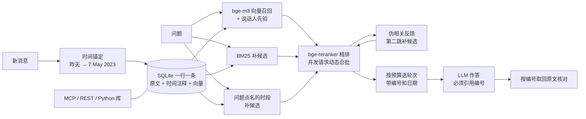

# MemoCore

[](https://github.com/HHqm/MemoCoreAgent/actions/workflows/ci.yml)

[](LICENSE)

**原文为本、零 LLM 写入、评测可信**的 Agent 长期记忆引擎。

我调研了 Mem0、Graphiti 等高星记忆项目讨论最多的 issue，社区反复提到的问题有：垃圾记忆、不会处理时间、每次写入都调 LLM、评测复现不出来、结果查不到出处。它们有一个共同根源：**写入时用 LLM 把对话加工成另一种表示，而加工是有损的，加工结果又取代了原文。** MemoCore 反过来做：

- **原文永远不改写**：派生信息（时间注释、索引）只挂在原文旁边，每条上下文都能回溯到原始对话轮次。
- **写入不调用 LLM**：向量编码 + BM25 索引 + 规则时间锚定。
- **读取靠精排**：bge-m3 召回，BM25 补充候选，伪相关反馈做第二跳，问题点名时间或人时补候选、加分，bge-reranker 重排。
- **答案带出处**：回答必须引用原文轮次编号，无法引用的内容不许写；引用可以直接回原文核对。
- **能直接接入 Agent**：持久化记忆库加 MCP 服务和 REST 接口，Claude Code 一条命令就能用；用的是评测过的同一条读取路径，逐条回放 LoCoMo 后 1,540 题检索结果全部一致。
- **每个改动都要在同一预算下用数字证明**。

### 亮点一览

| 方面 | 实测结果 |
|---|---|
| 检索 | 同样 20 轮上下文，证据召回 76.4% → **88.4%**，多跳题 57.3% → **74.7%**；0 次 LLM 调用 |
| 端到端 | 比朴素检索准确率 **+5.3 个点**（配对检验 p = 0.017）；只用全量上下文 **6.5%** 的 token，达到其 91% 的准确率 |
| 可追溯 | **96.3%** 的回答带原文出处，准确率不降（p = 1.0） |
| 评测可信 | 配对 bootstrap 检验；裁判盲审一致率 80%，裁判 **0 题偏松**；六轮检索优化里否决了四项看似合理的做法 |
| 接入 | MCP + REST + Python 库；写入一条 24 ms，检索 295 ms；动态合批让并发吞吐 **+40%**；增量索引让 2 万条记忆时写后即查 2,375 → **317 ms** |
| 成本 | 每次调用按官方单价记账，全部实验合计 ¥15～29；关闭思考可让作答省 41%、裁判省 72% |



详见 [与高星项目的对比](docs/COMPARISON.md) 和 [评测方法](docs/EVALUATION.md)。

## 端到端结果（LLM 作答 + 严格裁判）

在 LoCoMo 上按固定种子抽了 300 题（每段对话 30 题）。回答模型是 `deepseek-flash`，严格裁判是 `deepseek-v4-pro`，四个系统用同一个回答模型和同一份 prompt：

| 系统 | 严格裁判准确率 | 95% 置信区间 | 证据召回 | 每题 prompt token |
|---|---:|---|---:|---:|
| `no_memory` | 0.0% | — | 0% | 256 |
| `naive_rag` | 49.7% | [44.0, 55.3] | 74.5% | 1,236 |
| **`hybrid_rag`** | **55.0%** | [49.3, 60.7] | 87.4% | 1,381 |
| `full_context` | 60.3% | [54.3, 66.0] | 99.7% | 21,310 |

- **hybrid_rag 对 naive_rag：+5.3 个点**，按题配对 bootstrap 95% CI [+1.3, +9.3]，p = 0.017。其中时间类题目 +6.9（p = 0.035）。
- **full_context 对 hybrid_rag：+5.3 个点**（p = 0.029），代价是每题 15 倍的 prompt token。也就是说，hybrid_rag 只用 **6.5% 的 token** 就拿到了全量上下文 **91% 的准确率**。
- **错误归因**：hybrid_rag 答错的 135 题里，只有 43 题是证据没召回全，另外 **92 题证据齐全却答错**。再细分：漏答要点 41%，多答了细节 33%，答错事实 11%，有证据仍拒答 8%，时间粒度和标准答案不一致 8%。现在的瓶颈在作答，不在检索。（后来的裁判盲审发现，"多答了细节"里有一部分是严格裁判把无害的补充判成了越界，见下面的裁判抽检。）

完整数据见 [docs/results/end_to_end_s300.md](docs/results/end_to_end_s300.md)。上表用的是首轮配置：v1 prompt，不含伪相关反馈。

### 作答环节迭代（同一批 300 题、同一检索结果，只换 prompt）

| prompt | 做法 | 严格裁判 | 对 v1（配对 95% CI，p） | 出处引用 |
|---|---|---:|---|---|
| v1 | 短语作答 | 55.0% | — | — |
| v2 | 按错误归因加规则 + few-shot 示范 | 56.3% | +1.3（[-2.0, +4.7]，p = 0.53） | — |
| **v3（默认）** | v2 + 引用约束：答案必须引用原文轮次 | 55.0% | +0.0（[-3.7, +3.3]，p = 1.0） | 96.3% 带引用，精确率 78.7%，100% 落在上下文内 |

- **prompt 调优碰到了噪声底**：每换一版都有 12～16 道题对错翻转，差值都不显著，所以不再在这个方向上花额度。
- **引用约束不损失准确率，换来可追溯**，代价是 prompt token +25%、输出 token 约 2.5 倍；只做 A/B、想省钱时用 `--prompt v1`。
- **剩下的差距在检索**：full_context 答对、hybrid_rag 答错的 31 题里，12 题是 hybrid 没召回全证据（7 题是多跳题）。为此加了伪相关反馈，见下一节。

详见 [docs/results/answer_stage_s300.md](docs/results/answer_stage_s300.md)。

## 检索诊断（LoCoMo 全部 1,540 题，不调用 LLM）

| 配置 | 预算 | 证据召回 | multi-hop | temporal 答案可见 | 平均上下文字符 |
|---|---:|---:|---:|---:|---:|
| 朴素向量检索 `naive_rag` | 20 轮 | 76.4% | 57.3% | 37.1% | 3,831 |
| + BM25 RRF 融合 + 重排 | 20 轮 | 84.0% | 64.6% | 37.1% | 4,146 |
| + BM25 补充候选 + 重排 | 20 轮 | 86.4% | 71.6% | 36.1% | 4,283 |
| + 时间锚定 | 20 轮 | 86.4% | 69.8% | 70.4% | 4,421 |
| + 伪相关反馈 | 20 轮 | 87.5% | 73.9% | 70.7% | 4,504 |
| **`hybrid_rag` 默认（再加时间感知查询、说话人先验）** | 20 轮 | **88.4%** | **74.7%** | **71.3%** | 4,520 |
| **`hybrid_rag` 默认** | **5 轮** | 78.5% | 55.2% | 65.4% | 1,263 |

- 同样 20 轮，证据召回 **+12.0** 个点，多跳题 **+17.4** 个点。
- 只用 **1/4 的上下文**（5 轮），召回就超过了朴素检索用 20 轮的结果。
- 时间锚定让时间类问题的答案可见率从 36.1% 提到 **70.4%**，上下文只多 3.2%。
- **伪相关反馈**：用问题向量加上重排前 2 名轮次的向量再检索一次，补 20 个候选给重排模型（仍按原问题打分）。多跳题证据召回 +4.1 个点，8 种参数组合全部有 +1.0～+1.3 的整体提升；代价是每题多重排 20 对，0 次 LLM 调用。之所以选这个方向而不是加预算，是因为排序分析显示：漏掉的证据只有 2.5% 排在 20～39 名，18% 排在 60 名以后或根本不在候选池里，加预算几乎没用。
- **六轮调研加优化**（[docs/results/optimization_rounds.md](docs/results/optimization_rounds.md)）：先查清漏掉的证据有 70%～80% 根本没进重排候选池，再参照 LongMemEval、MemMachine、Mem0、Anthropic Contextual Retrieval 等做法逐项实测：
  - **时间感知查询**：问题点名时间（"in October 2023"）时，把那段时间的轮次补进候选，这类题召回 93.7% → 96.1%。
  - **说话人先验**：问题只点名一个人时，96% 的证据是这个人自己说的，给其发言加分后整体 +0.5、开放域 +1.1。
  - **重排深度**：候选从 50 加到 100 只多 0.3 个点、重排量多 60%，保持 50。
  - **上下文向量没有采用**：只对单跳题有效，让重排也看上文时多跳题反而 -6.7。
  - **第 6 轮量上限**：91.7% 的证据能进重排候选池，最终 20 轮里是 88.4%。bge-m3 自带的多向量分数让第一阶段多召回 1.3 个点，但最终召回不涨、存储大 20 多倍，没有采用；把向量分数掺回重排分数只会变差。不花钱的检索改动到此为止。
- 三个反直觉的发现：BM25 与向量做 RRF 融合**反而更差**（多跳题 -5.2 个点）；邻近轮扩展在同预算下也是负收益；给每轮带上上文编码同样会让相邻轮互相挤占。

完整消融见 [docs/results/](docs/results/)。这些是作答之前的诊断指标，免费，用来先调好检索，再花钱跑端到端。

## 有什么

| 模块 | 内容 |
|---|---|
| 系统 | `no_memory`（下限）、`full_context`（上限）、`naive_rag`（朴素检索）、`hybrid_rag`（MemoCore 读取路径 + 时间锚定） |
| 写入 | 规则时间锚定（20 余条规则，"昨天 / 上周 / 去年夏天"换算成具体日期），每轮约 77 µs，0 次 LLM 调用 |
| 读取 | bge-m3 向量召回、BM25 补充候选（支持中文二元分词）、伪相关反馈第二跳、时间感知查询（问题点名的时段补候选）、说话人先验、bge-reranker-v2-m3 精排、按预算选取，按时间顺序渲染并带日期 |
| 作答 | 所有系统共用一份回答 prompt（`--prompt v1/v2/v3`）；默认 v3 要求答案引用原文轮次，引用会被剥离后再评分，并对照标注证据计算引用精确率和召回；思考模型撞到输出上限时自动加倍重试一次 |
| 指标 | 与官方口径一致的 token F1；严格、宽松两套 LLM 裁判；证据召回；答案可见率；token、前缀缓存命中、延迟 |
| 统计 | bootstrap 95% 置信区间；`compare` 按题配对比较两个运行，给出差值区间和 p 值；裁判盲审抽检（一致率、Wilson 区间、kappa、偏严 / 偏松） |
| 接入 | `MemoryStore`（SQLite 持久化、多用户隔离、按编号取原文、彻底删除）和 MCP 服务（remember / recall / read_memories / forget），读取路径与评测完全一致 |
| 工程 | 断点续跑；逐次计费（缓存命中、思考 token、高峰 / 低谷单价）与开跑前预估；LLM 响应、向量、重排分数全部按内容寻址缓存；设置不一致拒绝续跑；`--qa-ids` 定向抽查；`--mock` 离线全流程；GPU 半精度与批量编码；GitHub Actions 跑 93 个离线测试，已发布结果用到的 prompt 哈希被测试锁定 |

## 接入 Agent：MCP、REST 与 Python 库

评测用的读取路径就是实际使用的那条：`MemoryStore` 把每条消息原样存进 SQLite，读取时在存好的轮次上构建同一个 `HybridRAGSystem`。

**接入 Claude Code**（其他支持 MCP 的客户端同理）：

```bash
claude mcp add memocore -- D:\envs\timeseries\Scripts\memocore.exe mcp --user me
```

服务提供四个工具：

| 工具 | 作用 |
|---|---|
| `remember` | 原样存一条消息，写入时完成时间锚定和向量编码，返回可引用的编号（如 `[D3:12]`） |
| `recall` | 按问题取回最相关的若干条，按时间顺序带编号和日期返回，可以直接放进 prompt |
| `read_memories` | 按编号取回原文，用来核对回答里的引用 |
| `forget` | 按编号永久删除，连同时间注释和向量一起删；清空整个用户只能通过库或命令行，Agent 不能一键全删 |

**REST 接口**（FastAPI，接口文档在 `/docs`，监听非本机地址时必须设置 `MEMOCORE_SERVER_TOKEN`）：

```bash
memocore serve --port 8000
```

```bash
curl -X POST 127.0.0.1:8000/users/alice/memories -H "Content-Type: application/json" -d "{\"messages\": [{\"text\": \"I adopted a beagle named Max yesterday\"}]}"
```

```bash
curl "127.0.0.1:8000/users/alice/recall?query=What%20is%20my%20dog%20called%3F"
```

并发检索时，`BatchingReranker` 把 3 ms 内到达的重排请求合成一次 GPU 调用（单个请求不等待）。真实 HTTP 压测：并发 16 时吞吐 3.5 → 4.9 次/秒，p95 延迟 5.2 → 3.9 秒；单卡上限受重排计算量限制，详见 [docs/results/serving.md](docs/results/serving.md)。

**作为 Python 库**：

```python
from memocore.config import Settings
from memocore.embeddings import SentenceTransformerEmbedder
from memocore.retrieval.rerank import CrossEncoderReranker
from memocore.store import MemoryStore

settings = Settings.from_env()
store = MemoryStore(
    "memory.sqlite",
    SentenceTransformerEmbedder(settings.embedding_model),
    CrossEncoderReranker(settings.reranker_model),
)
store.add("alice", "I adopted a beagle named Max yesterday")  # -> Memory(id="D1:1", time_note="time: yesterday = ...")
recall = store.search("alice", "What is my dog called?")      # recall.context 可直接放进回答 prompt
store.get("alice", ["D1:1"])                                  # 按引用编号取回原文
store.forget("alice")                                         # 删除这个用户的全部记忆
```

- **一条消息一行**：原文、时间注释、向量存在同一行，同一个事务写入；删除时一起删，并开启 SQLite `secure_delete` 覆写被删内容。测试会直接扫描数据库文件，确认被删的原文已经不在。
- **编号永不复用**：删掉的编号不会再分配给新消息，旧回答里的引用不会指向别的内容。
- **会话自动切分**：调用方可以传会话键；不传时，与上一条间隔超过 30 分钟就开新会话。时间锚定按会话日期换算。
- **多用户隔离**：每个用户的记忆分开存、分开建索引。
- **增量索引**：写入只把新轮次追加进索引（BM25 的 idf 查询时现算，分数和一次建好的逐位相同），删除才全量重建；向量和时间注释直接读库，不重算。扩展时生成新的索引对象，正在进行的并发检索不受影响。记忆从 600 条涨到 2 万条，写入后紧接着检索的延迟只从 303 ms 变成 317 ms（[实测](docs/results/serving.md#记忆越存越多增量索引)）。

**逐条回放核对**（`memocore memory-replay`，不调用 LLM）：把 LoCoMo 的 5,882 轮对话一条一条写进记忆库，再用 1,540 道题检索。

| 指标 | 结果 |
|---|---|
| 和评测过的 `HybridRAGSystem` 选出的轮次逐题一致 | **1,540 / 1,540** |
| 20 轮预算的证据召回 | 88.4%（与检索消融的默认配置一致，小数点后全部相同） |
| 写入一条消息（中位数 / p95，含向量编码和落盘） | 24 ms / 26 ms |
| 检索一次（中位数 / p95，主要是 bge-reranker 重排） | 295 ms / 334 ms |
| 写入后紧接着检索（增量索引；600 条 / 2 万条记忆） | 303 ms / 317 ms |
| 库文件大小（5,882 轮，含 1024 维向量） | 27 MB |

延迟是在 RTX 5060 笔记本上、关闭所有缓存，用一段 419 轮的对话测的。

## 快速开始

```bash
conda activate timeseries
```

```bash
cd D:\prru\memocore
```

```bash
pip install -e . --no-deps
```

```bash
python -m unittest discover -s tests -t .
```

数据集、bge-m3 和 bge-reranker-v2-m3 放在 `data/` 和 `models/` 下（这两个目录都不提交）。换一台机器时，先执行 `memocore download-locomo`；模型默认从 `models/` 读取，找不到时从 HuggingFace 下载。

### 1. 不花钱：先量检索

```bash
memocore retrieval-ablation --budgets 5,10,20
```

```bash
memocore retrieval-sweep --top-k 1,3,5,10,20 --chunk-turns 1,2,4
```

### 2. 离线检查流程

```bash
memocore run --system hybrid_rag --run-name hybrid-mock --max-conversations 1 --max-questions 20 --mock
```

### 3. 端到端评测（省额度的做法）

把 `.env.example` 复制为 `.env`，填入 `DEEPSEEK_API_KEY`。然后在固定种子的 300 题子集上跑：

```bash
memocore run --system hybrid_rag --run-name s300-hybrid_rag --max-questions 30
```

```bash
memocore run --system naive_rag --run-name s300-naive_rag --max-questions 30
```

```bash
memocore compare --baseline s300-naive_rag --candidate s300-hybrid_rag
```

结果写在 `runs/<run-name>/summary.md`；中途中断的话，用同样的命令重跑即可续上，已完成的题不会再调用。命令开始前会打印本次要调用多少次模型。

为了省额度，默认做了这些：

- **规则预判**：拒答、精确匹配这类一眼能判的情况不调用裁判模型。在 1,502 条已有判定上，规则结论和 LLM 裁判 100% 一致。像 `no_memory` 这种几乎总是拒答的系统，裁判调用基本可以全部省掉。
- **默认只跑严格裁判**：宽松裁判用 `--judge both` 再开。
- **前缀缓存预热**：每段对话先单独答一题，`full_context` 的缓存命中率从 36% 提到 96%。
- **用 300 题子集做配对对比**：差值显著性靠配对检验，不靠堆题量。
- **只重试失败项**：被截断、无法解析的回答和判定不进缓存，续跑时只重做这些。
- **定向抽查**：改 prompt 后先用 `--qa-ids` 只重答几十道有代表性的题，看行为对不对；这些回答会进缓存，正式跑 300 题时直接复用。

```bash
memocore run --system hybrid_rag --run-name probe --qa-ids "conv-26#q0019,conv-30#q0060" --judge none
```

### 4. 抽检裁判（盲标）

```bash
memocore audit-export --run-name s300-full_context s300-naive_rag s300-hybrid_rag s300-hybrid_rag-v3 --n 100
memocore audit-label --csv runs/audit_strict.csv
memocore audit-score --csv runs/audit_strict.csv
```

- **盲标**：标注表里没有裁判结论，也没有系统名，人工标签不会被裁判或"这是哪个系统"带偏；打分时才按题号把裁判结论对回来。
- **跨系统抽样**：题目不重复，几个运行轮流分配，裁判要是偏袒某个系统也能看出来。
- **只抽 LLM 裁判判定的题**：精确匹配和"没提到"这类由规则判定的题按构造就是对的，抽它们只会虚高一致率（`--include-rule` 可以加回来）。
- **终端逐题标注**：显示问题、标准答案、回答和原文证据，按 1 / 0 / ? 标注，每题都即时保存，可以随时退出再续。也可以直接在 CSV 的 `human_label` 列填 对 / 错 / ?。
- **输出**：一致率及 Wilson 置信区间、Cohen's kappa、裁判偏严/偏松各几题、同一批题上裁判与人工各自算出的准确率、按系统和题型的一致率，以及每道分歧题的裁判理由。

**结果**（参照标签由 Claude 盲审给出，不是人工，详见 [docs/results/judge_audit.md](docs/results/judge_audit.md)）：

| 指标 | 结果 |
|---|---|
| 与严格裁判的一致率 | 80%（95% 区间 71%～87%），kappa 0.61 |
| 裁判偏松 / 偏严 | **0 题 / 20 题** |
| 同一批 100 题的准确率 | 裁判 42%，盲审 62% |

- **严格裁判不放水**：报告的准确率是保守下限。
- **偏严集中在"不越界"**：多带一个与题目相符的细节（"A new Prius"、"Evening of 11 July"）也会被判错。
- **系统比较没有被放大**：偏严程度在 hybrid（+29）和 full_context（+19）上比 naive（+8）更明显，所以 hybrid 对 naive 的领先更可能被低估（每个系统约 25 题，只看方向）。

## API 使用与成本

每次调用都记录命中缓存、未命中、思考 token 和调用时段，按 DeepSeek 官方单价算出花费（元）；`run` 和 `judge` 开跑前打印预计花费和几点起半价；`memocore cost` 统计各次运行实际花了多少。到目前为止全部运行合计 **¥15～29**，一次 300 题的系统评测（作答 + 裁判）约 ¥1.3～3.3。

审计和小样本探测（约 ¥1）的发现，详见 [docs/results/api_usage.md](docs/results/api_usage.md)：

| 发现 | 数据 |
|---|---|
| 输出几乎全是思考 | 回答本身约 15 token，每次却输出 120～300 token；裁判每次约 370 |
| 检索类提示词几乎不命中前缀缓存 | 记忆放在最前面、每题不同，v3 只有 2.5% 命中；固定文本前置的 v4 命中 16.5%，但输出是大头，总花费只少约 4% |
| 关闭思考最省 | 作答输出 -95%、花费 -41%、延迟 -58%；裁判花费 -72%，与盲审一致率从 80% 变为 89%（更宽松） |
| 思考模式下 temperature 不生效 | 同一 prompt 重答，43% 的答案会变（关闭思考后 23%），本地响应缓存是结果可复现的前提 |
| 低谷时段半价 | 工作日北京时间 9:00～12:00、14:00～18:00 以外和周末全天 |

关闭思考会改变答案和判分，所以还没有替换默认值；可以用 `--reasoning none` 试。

## 实际花费（300 题子集，三个系统）

| 环节 | prompt token（其中命中缓存） | 输出 token |
|---|---:|---:|
| naive_rag 作答 | 37 万（4.6 万） | 4.2 万 |
| hybrid_rag 作答 | 41 万（5.9 万） | 3.7 万 |
| full_context 作答 | 639 万（615 万） | 4.2 万 |
| 三个系统的严格裁判 | 21 万 | 20 万 |
| 作答迭代：v2、v3 各 300 题，加 4 次定向抽查 | 107 万（42 万） | 16 万 |
| 作答迭代的严格裁判 | 14 万 | 13 万 |

重排在笔记本 GPU 上每题约 200～300 ms，分数有缓存。

## 性能优化

在同一台 RTX 5060 笔记本上测得：

| 环节 | 优化前 | 优化后 | 做法 |
|---|---:|---:|---|
| 建索引（约 1 万段文本） | 143.4 s | 51.3 s | GPU 半精度（召回变化不超过 0.4 个点） |
| 单次检索 | 16.8 ms | 0.8 ms | 同一段对话的问题批量编码 |
| 重复完整扫描 | — | 3.5 s | 向量磁盘缓存全部命中 |
| 第二轮消融（8 种配置 × 3 档预算） | 516 s（第一轮） | 110 s | 重排分数内容寻址缓存 |
| 并发检索吞吐（HTTP，并发 16） | 3.5 次/秒 | 4.9 次/秒 | 动态合批：3 ms 内的重排请求合成一次 GPU 调用 |
| 并发检索 p95 延迟（HTTP，并发 8） | 2,625 ms | 1,991 ms | 同上；单个请求不等待，延迟不变 |

## 路线图

1. **多跳检索**：多跳题仍有约 1/4 的证据没召回，而且大多排在向量排序 160 名以后。MemMachine 的实测显示 LLM 拆题在 LoCoMo 上只多 0.5 个点，所以优先考虑从召回源头补（实体索引、会话级召回），而不是花额度拆题。
2. **冲突感知读取**：同一属性多次变化时，按时间排序返回并标注哪条最新（用 LongMemEval knowledge-update 题验证）。
3. **带质量门的派生索引**：LLM 抽取的实体卡片、事实，每条都必须能回链到原文轮次并通过忠实性校验。
4. **重排降本**：只在向量检索不确定时才重排（第 4 轮实测：候选 30 时少 1.2 个点、重排量少 25%）。
5. **服务化**：MCP、REST、多用户隔离、动态合批和压测已完成；还差增量向量索引（用户记忆很多时不必每次重建）、多副本共享存储；接入 RepoPilot。
6. **更多基准**：LongMemEval 子集、LoCoMo-Refined 交叉评测；以 Mem0 作为外部对照；人工复核裁判盲审的分歧题。

## 目录

```text
src/memocore/
  datasets/locomo.py   数据加载，题型编号与官方一致
  temporal.py          写入时时间锚定（规则，不调用 LLM）
  store.py             持久化记忆库 MemoryStore：SQLite、多用户、按编号取原文、彻底删除
  mcp_server.py        MCP 服务：remember / recall / read_memories / forget
  http_server.py       REST 接口（FastAPI），可选 Bearer 鉴权
  retrieval/           BM25（含中文二元分词）、RRF 与候选池、交叉编码器重排
  systems/             no_memory、full_context、naive_rag、hybrid_rag
  prompts.py           所有系统共用的回答 prompt（v1～v3，v3 要求引用出处）
  metrics.py           F1（复刻官方口径）、证据召回、答案可见率
  judge.py             严格 / 宽松裁判与输出解析
  runner.py            回答、裁判、汇总
  audit.py             裁判盲标抽检：跨系统抽样、终端标注、一致率与 kappa
  compare.py, stats.py 配对对比、bootstrap 与 Wilson 置信区间、kappa
  retrieval_eval.py    不调用 LLM 的检索扫描、消融，以及记忆库逐条回放核对
  llm.py, embeddings.py, kvcache.py  模型客户端（含思考程度）与各类缓存
  pricing.py, spend.py  官方单价、高峰 / 低谷判断、逐次计费与花费统计
docs/                  对比、评测方法、可借鉴项目、实测结果
tests/                 离线单元测试（mock 模型 + 哈希向量，不需要 API Key）
```
